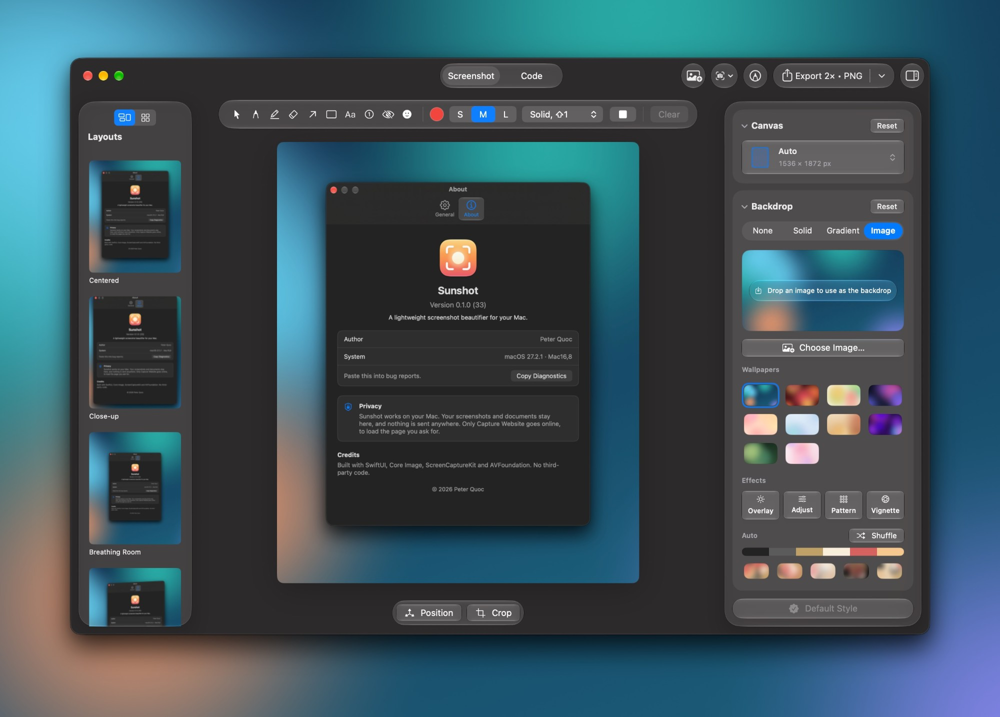

# Sunshot

Make your screenshots look good before you share them.

Sunshot is a small, fast Mac app for dressing up screenshots. Drop one in, choose a backdrop and a layout, and
export an image that's ready for a post, a slide, a blog or a product page.

## What you can do

- **Backdrops.** Solid colours, gradients, built-in wallpapers or a photo of your own, with blur, patterns and a
  vignette. Sunshot can also build a backdrop from your screenshot's own colours.
- **Frames and shadows.** Rounded corners, borders, window frames and soft shadows you can light from any side.
- **Layouts.** Centre, zoom in, tilt or give the shot room to breathe in one click, or put several screenshots
  side by side.
- **Annotations.** Arrows, shapes, text, numbered steps and highlights, plus blur or pixelate for anything
  private.
- **Code.** Paste a snippet and get a clean, highlighted code image.
- **Capture.** Grab an area, a window or a web page straight into Sunshot.
- **Export.** PNG, JPEG or HEIC at any size, copy to the clipboard, export many at once, or turn a layout into a
  short video.

## Private by design

Your screenshots stay on your Mac. Sunshot never uploads them; the only time it goes online is to load a web page
you ask it to capture, or to check whether a new version is out.

## Get Sunshot

Download the latest version from the [Releases page](https://github.com/pqBrain/SunShot/releases/latest).
Sunshot needs macOS 26 or later. The first time you open it, Control-click Sunshot in Applications and choose
**Open**.
